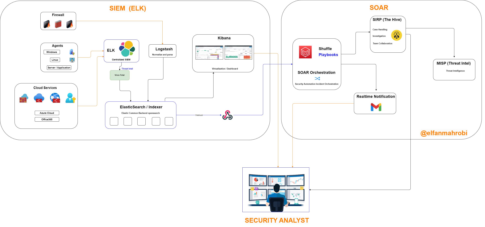

# SIEM and SOC Home Lab

<p align="center">
  
  
  
</p>

<p align="center">
  
  
  
  
</p>

## Overview

This repository documents the development of a practical **Security Information and Event Management (SIEM)** and **Security Operations Center (SOC)** home lab.

The current implementation focuses on building a centralized security monitoring platform using the **Elastic Stack**, including Elasticsearch, Logstash, and Kibana.

The environment is designed to collect, process, normalize, index, visualize, and analyze security events generated by endpoints, servers, applications, firewalls, and cloud services.

The long-term objective is to expand the SIEM environment into an integrated SOC ecosystem that supports:

- Security monitoring
- Detection engineering
- Alert triage
- Incident investigation
- Threat intelligence enrichment
- Case management
- Security orchestration
- Automated incident response
- Real-time notification

> [!IMPORTANT]
> The Elastic Stack SIEM foundation has been implemented. SOAR, TheHive, MISP, automated notifications, and other incident-response integrations remain part of the development roadmap.

---

## Architecture



The architecture diagram represents the target design for the SIEM and SOC home lab.

The architecture is divided into two primary areas:

1. **SIEM using the Elastic Stack**
2. **SOAR and incident response ecosystem**

### Current Implementation

The following components have been implemented:

- Elasticsearch
- Logstash
- Kibana
- Centralized SIEM platform
- Initial log ingestion pipeline
- Security dashboard foundation

### Planned Implementation

The following components remain under development or are planned:

- Windows log onboarding
- Linux log onboarding
- Firewall log onboarding
- Cloud service log onboarding
- Detection rules
- MITRE ATT&CK mapping
- Shuffle SOAR
- TheHive
- MISP
- Automated email notification
- Security automation playbooks
- Automated case creation
- Threat intelligence enrichment

---

## Architecture Components

### SIEM Layer

The SIEM layer is responsible for collecting, processing, storing, and visualizing security event data.

#### Elasticsearch

Elasticsearch provides centralized storage and indexing for security events collected from multiple log sources.

Primary functions:

- Store security events
- Index normalized log data
- Support event searches
- Support event correlation
- Provide data to Kibana
- Maintain security event history

#### Logstash

Logstash receives events from different log sources before sending the processed data to Elasticsearch.

Primary functions:

- Receive log data
- Parse raw security events
- Normalize log fields
- Filter unnecessary information
- Enrich security events
- Forward processed events to Elasticsearch

#### Kibana

Kibana provides the visualization and investigation interface for the SIEM environment.

Primary functions:

- Visualize security events
- Build security dashboards
- Search centralized logs
- Investigate suspicious activities
- Monitor authentication activity
- Analyze firewall and endpoint events
- Support security analysts during investigations

#### Agents and Log Forwarders

Agents and log forwarders collect security events from endpoints, servers, network devices, and applications.

Planned log sources include:

- Windows endpoints
- Linux servers
- Application servers
- Web servers
- Firewalls
- Cloud services
- Microsoft 365
- Microsoft Azure

---

## Target SOAR Ecosystem

The SOAR environment will extend the SIEM implementation by introducing security orchestration, automation, case management, and threat intelligence.

### Shuffle

Shuffle will be used as the SOAR orchestration platform.

Planned functions:

- Receive alerts from the SIEM
- Execute security automation workflows
- Enrich indicators
- Create incident cases
- Send security notifications
- Coordinate incident-response actions

### TheHive

TheHive will be used for Security Incident Response Platform functionality.

Planned functions:

- Incident case management
- Alert tracking
- Investigation documentation
- Task assignment
- Analyst collaboration
- Incident lifecycle management
- Evidence and artifact management

### MISP

MISP will be used as a threat intelligence platform.

Planned functions:

- Store threat intelligence indicators
- Enrich IP addresses, domains, URLs, and hashes
- Correlate indicators with SIEM events
- Share threat intelligence between security tools
- Support indicator-based investigations

### Real-Time Notification

The notification component will send incident and alert information to security analysts.

Planned notification methods:

- Email notification
- Gmail integration
- Webhook notification
- Security alert summary
- Incident escalation notification

---

## SIEM Data Flow

The current SIEM data flow follows this process:

```text
Endpoints, Servers, Firewalls, Applications, and Cloud Services
                              |
                              v
                  Agents and Log Forwarders
                              |
                              v
                          Logstash
                              |
                              v
                       Elasticsearch
                              |
                              v
                           Kibana
                              |
                              v
                  Security Analyst Investigation
```

### Processing Workflow

1. Endpoints, servers, applications, firewalls, and cloud services generate security events.
2. Agents or log forwarders collect events from the log sources.
3. Logstash receives the events.
4. Logstash parses, filters, normalizes, and enriches the events.
5. Elasticsearch stores and indexes the processed security data.
6. Kibana presents the events through searches, dashboards, and visualizations.
7. Security analysts review and investigate suspicious security activity.

---

## Planned SOAR Workflow

The target SOAR workflow will follow this process:

```text
SIEM Detection or Alert
          |
          v
        Webhook
          |
          v
      Shuffle SOAR
          |
          +--------------------------+
          |                          |
          v                          v
Threat Intelligence             TheHive Case
   Enrichment                     Creation
          |                          |
          +-------------+------------+
                        |
                        v
               Email Notification
                        |
                        v
             Security Analyst Review
                        |
                        v
              Incident Investigation
```

The workflow remains part of the target architecture and has not yet been fully implemented.

---

## Project Objectives

The primary objectives of this project are:

1. Build a centralized security log monitoring platform.
2. Understand the complete SIEM data pipeline.
3. Practice security log collection and forwarding.
4. Develop log parsing and normalization pipelines.
5. Build security dashboards in Kibana.
6. Create practical security detection rules.
7. Simulate suspicious security events.
8. Validate detection and alerting capabilities.
9. Document security investigation procedures.
10. Map detection rules to the MITRE ATT&CK framework.
11. Develop SOC alert-triage procedures.
12. Integrate security orchestration and automation.
13. Build a practical cybersecurity portfolio project.

---

## Technology Stack

### Implemented

- Elasticsearch
- Logstash
- Kibana
- Linux
- Elastic Stack
- Centralized security logging
- Security event visualization

### In Development

- Windows event log collection
- Linux system log collection
- Firewall log collection
- Application log collection
- Kibana security dashboards
- Detection rules
- Alerting
- MITRE ATT&CK mapping

### Planned

- Shuffle SOAR
- TheHive
- MISP
- Webhook integration
- Email notification
- Threat intelligence enrichment
- Automated case creation
- Security automation playbooks
- Incident-response workflows

---

## Implementation Status

| Component | Primary Function | Status |
|---|---|---|
| Elasticsearch | Security event storage and indexing | Implemented |
| Logstash | Event collection, parsing, and normalization | Implemented |
| Kibana | Security dashboard and event analysis | Implemented |
| Windows Logs | Windows security event monitoring | In Development |
| Linux Logs | Linux authentication and system monitoring | In Development |
| Firewall Logs | Network and firewall security monitoring | Planned |
| Cloud Logs | Cloud service monitoring | Planned |
| Detection Rules | Suspicious activity detection | In Development |
| MITRE ATT&CK Mapping | Detection coverage mapping | Planned |
| Shuffle | Security orchestration and automation | Planned |
| TheHive | Incident and case management | Planned |
| MISP | Threat intelligence management | Planned |
| Email Notification | Real-time analyst notification | Planned |

---

## Detection Use Cases

The home lab is designed to support several practical detection and monitoring scenarios.

### Authentication Monitoring

Planned authentication monitoring use cases:

- Multiple failed login attempts
- Successful login after repeated failures
- Brute-force authentication attempts
- Password-spraying activity
- Privileged account authentication
- Login activity outside expected hours
- Authentication from an unusual source
- Multiple accounts accessed from one source

### Windows Monitoring

Planned Windows detection use cases:

- Suspicious PowerShell execution
- Encoded PowerShell commands
- New local user creation
- User added to a privileged group
- Security group membership changes
- Suspicious service creation
- Windows Defender security events
- Audit log clearing
- Unusual process execution
- Remote desktop login activity

### Linux Monitoring

Planned Linux detection use cases:

- Multiple failed SSH login attempts
- Successful root login
- Repeated sudo failures
- Sudo command execution
- New user creation
- User or group modification
- Authentication log manipulation
- Suspicious process activity
- Unauthorized configuration changes

### Firewall and Network Monitoring

Planned network detection use cases:

- Repeated denied connections
- Port-scanning activity
- Suspicious outbound connections
- Connections from unauthorized networks
- Unusual traffic volume
- Communication with suspicious IP addresses
- Access to unusual destination ports
- Multiple connection attempts across different ports

### Threat Intelligence Monitoring

Planned threat intelligence use cases:

- Connection to a malicious IP address
- DNS request to a suspicious domain
- Detection of a known malicious file hash
- Threat intelligence indicator matching
- Automatic IP reputation lookup
- Automatic domain reputation lookup

---

## Repository Structure

```text
siem-soc-homelab/
├── README.md
├── LICENSE
├── .gitignore
│
├── architecture/
│   ├── soc-architecture.png
│   ├── current-siem-architecture.md
│   └── target-soc-architecture.md
│
├── documentation/
│   ├── 01-project-overview.md
│   ├── 02-lab-requirements.md
│   ├── 03-network-topology.md
│   ├── 04-installation-guide.md
│   ├── 05-log-source-onboarding.md
│   ├── 06-dashboard-configuration.md
│   ├── 07-detection-engineering.md
│   └── 08-troubleshooting.md
│
├── elasticsearch/
│   ├── configuration/
│   ├── index-templates/
│   └── lifecycle-policies/
│
├── logstash/
│   ├── pipelines/
│   ├── patterns/
│   └── examples/
│
├── kibana/
│   ├── dashboards/
│   ├── visualizations/
│   ├── detection-rules/
│   └── screenshots/
│
├── agents/
│   ├── windows/
│   ├── linux/
│   └── server-application/
│
├── sample-logs/
│   ├── firewall/
│   ├── windows/
│   ├── linux/
│   └── application/
│
├── use-cases/
│   ├── failed-login-detection.md
│   ├── brute-force-detection.md
│   ├── suspicious-powershell.md
│   ├── privileged-account-monitoring.md
│   └── firewall-denied-traffic.md
│
├── testing/
│   ├── test-scenarios.md
│   └── validation-results.md
│
└── roadmap/
    └── soc-development-roadmap.md
```

---

## Implementation Roadmap

### Phase 1: SIEM Foundation

- [x] Design the target SOC architecture
- [x] Prepare the SIEM lab environment
- [x] Deploy Elasticsearch
- [x] Deploy Logstash
- [x] Deploy Kibana
- [x] Validate communication between ELK components
- [x] Access the Kibana management interface
- [x] Establish the centralized SIEM foundation

### Phase 2: Log Source Integration

- [ ] Integrate Windows security event logs
- [ ] Integrate Linux authentication logs
- [ ] Integrate firewall logs
- [ ] Integrate server logs
- [ ] Integrate application logs
- [ ] Integrate cloud service logs
- [ ] Validate event timestamps
- [ ] Validate parsed fields
- [ ] Configure index templates
- [ ] Configure log retention policies

### Phase 3: Security Dashboard Development

- [ ] Create an authentication monitoring dashboard
- [ ] Create a Windows security dashboard
- [ ] Create a Linux security dashboard
- [ ] Create a firewall monitoring dashboard
- [ ] Create a security overview dashboard
- [ ] Create an alert summary dashboard
- [ ] Export and document Kibana dashboards

### Phase 4: Detection Engineering

- [ ] Create failed login detection
- [ ] Create brute-force detection
- [ ] Create suspicious PowerShell detection
- [ ] Create privileged account monitoring
- [ ] Create user account creation detection
- [ ] Create firewall port-scan detection
- [ ] Create suspicious outbound traffic detection
- [ ] Map detection rules to MITRE ATT&CK

### Phase 5: Detection Validation

- [ ] Develop security test scenarios
- [ ] Generate test security events
- [ ] Validate log ingestion
- [ ] Validate field parsing
- [ ] Trigger detection rules
- [ ] Review false-positive results
- [ ] Tune detection thresholds
- [ ] Document investigation results

### Phase 6: SOC Operations

- [ ] Define the alert-triage process
- [ ] Define incident classifications
- [ ] Create an incident severity matrix
- [ ] Develop investigation checklists
- [ ] Define incident-escalation procedures
- [ ] Create investigation playbooks
- [ ] Define incident-closure criteria

### Phase 7: SOAR Integration

- [ ] Deploy Shuffle
- [ ] Configure SIEM webhook integration
- [ ] Receive SIEM alerts in Shuffle
- [ ] Create automated enrichment workflows
- [ ] Create email notification workflows
- [ ] Build security automation playbooks

### Phase 8: Case Management

- [ ] Deploy TheHive
- [ ] Integrate Shuffle with TheHive
- [ ] Automatically create cases from SIEM alerts
- [ ] Assign incident severity
- [ ] Assign case ownership
- [ ] Track investigation activities
- [ ] Document incident resolution

### Phase 9: Threat Intelligence

- [ ] Deploy MISP
- [ ] Import threat intelligence indicators
- [ ] Integrate MISP with Shuffle
- [ ] Enrich IP addresses
- [ ] Enrich domains and URLs
- [ ] Enrich file hashes
- [ ] Correlate indicators with SIEM events
- [ ] Automate indicator lookups

---

## Planned Documentation

The repository will include documentation for:

- Lab requirements
- Network topology
- Elastic Stack installation
- Elasticsearch configuration
- Logstash pipeline configuration
- Kibana dashboard creation
- Windows log onboarding
- Linux log onboarding
- Firewall log onboarding
- Detection rule development
- Detection validation
- MITRE ATT&CK mapping
- Alert triage
- Incident investigation
- SOAR integration
- Troubleshooting

---

## Security Testing

Security simulations must only be conducted in an isolated home lab or another explicitly authorized environment.

Planned validation methodology:

1. Select a detection use case.
2. Define the expected security event.
3. Generate the event in the lab environment.
4. Confirm that the event reaches Logstash.
5. Validate event parsing and normalization.
6. Confirm that Elasticsearch indexes the event.
7. Search for the event in Kibana.
8. Validate the detection rule.
9. Review the generated alert.
10. Document the investigation result.
11. Tune the rule if required.

---

## Security and Privacy

Sensitive information must not be committed to this repository.

Always remove or anonymize:

- Public IP addresses
- Private IP addresses
- Internal hostnames
- Internal domain names
- Usernames
- Email addresses
- API keys
- Access tokens
- Passwords
- Credentials
- Organization-specific logs
- Production configuration values
- Certificates
- Private keys
- Webhook URLs
- Customer information

Use placeholders within example configuration files:

```text
SIEM_SERVER_IP=<SIEM_SERVER_IP>
ELASTIC_USERNAME=<ELASTIC_USERNAME>
ELASTIC_PASSWORD=<ELASTIC_PASSWORD>
KIBANA_URL=<KIBANA_URL>
LOGSTASH_HOST=<LOGSTASH_HOST>
WEBHOOK_URL=<WEBHOOK_URL>
THEHIVE_API_KEY=<THEHIVE_API_KEY>
MISP_API_KEY=<MISP_API_KEY>
```

---

## Current Limitations

The current version of the project has the following limitations:

- The implementation currently focuses on the Elastic Stack SIEM foundation.
- Not all planned log sources have been onboarded.
- Detection rules are still under development.
- Automated incident-response workflows are not yet active.
- TheHive has not yet been integrated.
- MISP has not yet been integrated.
- Shuffle SOAR workflows have not yet been implemented.
- Real-time notification remains part of the roadmap.

These limitations will be addressed through future development phases.

---

## Future Improvements

Future improvements will include:

- Additional endpoint and network log sources
- Improved event normalization
- More advanced Kibana dashboards
- Custom detection rules
- MITRE ATT&CK coverage mapping
- Detection rule tuning
- False-positive reduction
- Security alert enrichment
- Automated incident case creation
- Threat intelligence integration
- SOAR playbooks
- Real-time analyst notifications
- Incident metrics and reporting

---

## Disclaimer

This repository is intended for:

- Educational purposes
- Cybersecurity research
- Blue-team practice
- Security engineering practice
- Detection engineering practice
- Home lab documentation
- Professional portfolio development

All tests and security simulations must only be performed against systems owned by the operator or systems where explicit authorization has been provided.

The architecture diagram includes both implemented and planned components. Refer to the implementation status and roadmap sections for the current project scope.

---

## Author

**Elfan Mahrobi**

Cybersecurity professional interests and experience in:

- Security engineering
- SIEM and SOC operations
- Threat detection
- Incident response
- Network security
- Cloud security
- Zero Trust Network Access
- Security assessment
- Threat modeling
- Security automation

GitHub: https://github.com/elfanmahrobi

---

## Project Status

The **Elastic Stack SIEM foundation has been successfully implemented**.

The next development priorities are:

1. Onboard Windows, Linux, and firewall log sources.
2. Create security monitoring dashboards.
3. Develop practical detection use cases.
4. Validate detections through controlled simulations.
5. Map detection rules to MITRE ATT&CK.
6. Document SOC investigation procedures.
7. Continue with Shuffle, TheHive, and MISP integration.

---

<p align="center">
  <strong>Built for cybersecurity learning, security monitoring, detection engineering, and SOC development.</strong>
</p>
